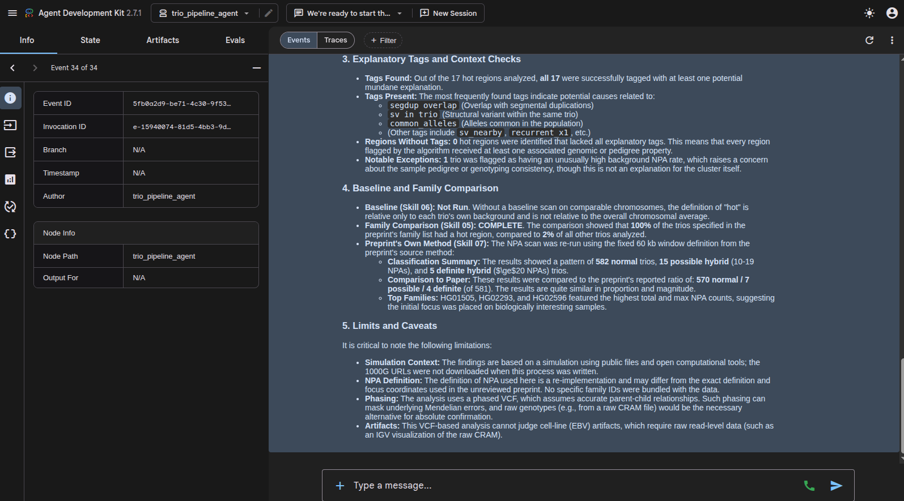

# Genetic Study Replication Pipelines

Five experimental pipelines that try to re-run, on one person's data, the analyses described in a handful of published papers and preprints. Each is a set of "skills" (a `SKILL.md` plus a script) and an instruction file (`AGENTS.md`) written to be driven by an AI agent.

> **Read [DISCLAIMER.md](DISCLAIMER.md) first.** These pipelines were written by  Claude Sonnet 5.5 (an AI model made by Anthropic), are for entertainment and experimentation only, are not validated, and must not be used for medical, health, ancestry, legal or any other real decision.

## The pipelines

| Folder | What it does | Input | Agent instructions |
|---|---|---|---|
| [`ghost-ancestry-pipeline`](ghost-ancestry-pipeline) | Applies the approach of Zhang et al., *Science* 2026 (doi:10.1126/science.aef8874): align, genotype and phase one genome, add it to a 503-sample 1000 Genomes cohort, build genealogies with Relate, run TRACE, and label segments as Neanderthal / Denisovan / Ghost. Denisovan segments are screened for super-archaic pieces. | Two FASTQ files, or one CRAM/BAM | `AGENTS.md` |
| [`personal-pipeline`](personal-pipeline) | Removed. It contains no logic; see <https://starseedgenetics.com/> instead. | n/a | n/a |
| [`trio-pipeline`](trio-pipeline) | Tries to reproduce the preprint's "nonparental allele" clusters in the public 1000 Genomes trios (for example HG01505 and HG02293 at chr3:75.5 Mb), including the preprint's own method and context checks (segmental duplications, structural variants, background rate). | Public 1000 Genomes files, downloaded by the pipeline | `AGENTS.md` |
| [`psi-genetics-pipeline`](psi-genetics-pipeline) | Compares one person's genotypes with the sites reported in two studies (Wahbeh et al. 2021 and 2026, *EXPLORE*): rs117910193 (TNRC18) and a lookup of 212 rsIDs. It writes a report that sets the genotypes beside what the studies found. It does not measure anything about psychic ability. | Array raw data (23andMe, AncestryDNA, MyHeritage), VCF, CRAM, BAM or FASTQ | `AGENTS.md` |
| [`striatum-project`](striatum-project) | Measures the caudate, putamen and the tissue between them on a T1 brain MRI (FreeSurfer SynthSeg) and compares the numbers with age- and sex-matched IXI reference subjects. | DICOM folder or NIfTI T1 scan | `AGENTS.md` |

Each skill writes a `results/<skill>.json` with a status (`OK`, `WARN`, `FAIL`, `SKIPPED`), a verdict and metrics, and a log in `logs/`. The agent is told to report only numbers that come from those files.

## Layout of a pipeline

```
<pipeline>/
├── AGENTS.md               instructions given to the agent
├── .agent/skills/<name>/   one folder per step: SKILL.md and its script(s)
├── config.env              settings (trio pipeline)
└── workspace/ or repo/     the agent's working area; outputs are written here
```

The exact layout differs between pipelines. Each one's own documentation is listed under "Running" below.

## Running a pipeline

Every pipeline can be driven by an agent. This repository includes a small Go launcher built on the [Agent Development Kit for Go](https://github.com/google/adk-go) that talks to a local [Ollama](https://ollama.com) model. It is an unsupported example, not a product (see the disclaimer).

### Requirements for the launcher

- Go 1.26 or later (Go downloads the toolchain version named in `go.mod` if needed).
- A running Ollama server with the default model pulled (`ollama pull gemma4:34b`). Any other model must support tool calling.

### Launcher settings

| Variable | Meaning | Default |
|---|---|---|
| `PIPELINE` | Folder name of the pipeline to run, for example `trio-pipeline`. Required. | none |
| `PIPELINE_AGENT` | Folder inside the pipeline that holds `skills/`. | `.agent` |
| `OLLAMA_MODEL` | Ollama model name. | `gemma4:e4b` or `muse-glimmer:30b-q4_K_M` suggested |
| `OLLAMA_HOST` | Ollama server address. | `http://localhost:11434` |

Run it from the repository root:

```bash
PIPELINE=trio-pipeline go run . console     # chat in the terminal
PIPELINE=trio-pipeline go run . web api webui                     # web UI
```

The launcher loads the pipeline's skills and instruction file, and gives the agent a `run_skill_script` tool that runs the skill scripts from the pipeline folder. Then tell the agent what to do, for example "run the whole pipeline".

#### Increasing the web UI timeouts

The web server's default timeouts (15s read and write) are too short for a slow local model. Raise them with flags on the `web` and `api` sub-launchers:

```bash
PIPELINE=trio-pipeline go run . web -write-timeout 30m -read-timeout 30m -idle-timeout 30m api -sse-write-timeout 30m webui
```

| Flag | Applies to | Default |
|---|---|---|
| `-write-timeout` | `web` | 15s |
| `-read-timeout` | `web` | 15s |
| `-idle-timeout` | `web` | 60s |
| `-sse-write-timeout` | `api` | 120s |

Values use Go duration syntax, such as `90s` or `30m`. The launcher also caps each model request at 10 minutes (`modelTimeout`) and each skill script at 600 seconds (`scriptTimeout`), both in [`main.go`](main.go). Edit them there if the model or a script needs longer.

Small local models often struggle with long, multi-step pipelines. If the agent loses track, use a larger model or run the skills yourself as described below.

### Per-pipeline instructions

#### `trio-pipeline`

Needs `bcftools`, `tabix`, `bgzip`, `curl` and Python 3 with `numpy` and `cyvcf2` (see [`requirements.txt`](requirements.txt)). Edit `config.env` if needed; any value can also be set from the shell. From inside `trio-pipeline/`:

```bash
bash workspace/run_all.sh                          # all skills
BASELINE_CHROMS="2 4" bash workspace/run_all.sh    # also scan chr2 and chr4 as a baseline
MANUAL_DIR=/path/to/downloads bash workspace/run_all.sh   # files you downloaded yourself
CHROM=3 bash .agent/skills/03_npa_scan/03_npa_scan.sh     # one skill
```

Or with the launcher: `PIPELINE=trio-pipeline go run . console`. Results are in `workspace/results/`, with the final report in `FINAL_REPORT.txt`. See [`trio-pipeline/README.md`](trio-pipeline/README.md) and `AGENTS.md`.

#### `personal-pipeline`

Removed. There is nothing to run here; use <https://starseedgenetics.com/> instead. This repository is not affiliated with that site (see the disclaimer).

#### `ghost-ancestry-pipeline`

The heaviest pipeline: a full run takes days and needs Relate (licensed for academic, non-commercial use only) and other third-party tools. See [`ghost-ancestry-pipeline/repo/THIRD-PARTY.md`](ghost-ancestry-pipeline/repo/THIRD-PARTY.md) and [`ghost-ancestry-pipeline/repo/README.md`](ghost-ancestry-pipeline/repo/README.md).

1. `pip install -r ghost-ancestry-pipeline/repo/requirements.txt`
2. Copy `repo/config.env.example` to `repo/config.env` and fill it in (input files, tool locations).
3. Check the chain first on simulated data with a known answer: see [`repo/testdata/README.md`](ghost-ancestry-pipeline/repo/testdata/README.md).
4. Run the 17 skills in order with the launcher: `PIPELINE=ghost-ancestry-pipeline go run . console`.

#### `psi-genetics-pipeline`

Needs Python 3.8 or later (standard library only), `bcftools`, `samtools`, `htslib` and `curl`. FASTQ input also needs `bwa-mem2` or `bwa`.

1. Edit `psi-genetics-pipeline/repo/config/run-config.json`: set `input.path` to your file (array files can go in `repo/input/`), and `reference.GRCh37` / `reference.GRCh38` for CRAM, BAM or FASTQ.
2. Run with the launcher: `PIPELINE=psi-genetics-pipeline go run . console`.

The report is `repo/results/psi-genetics-user-report.md`. See [`psi-genetics-pipeline/repo/PIPELINE.md`](psi-genetics-pipeline/repo/PIPELINE.md).

#### `striatum-project`

Needs FreeSurfer 8.2 (SynthSeg), `dcm2niix` and the Python packages in `striatum-project/repo/requirements.txt`. The simplest route is Docker (the image is about 25 GB):

```bash
cd striatum-project
docker build -t striatum -f repo/docker/Dockerfile repo/docker
docker run --rm -it \
  -v "$PWD":/project -w /project \
  -v /path/to/freesurfer_license.txt:/license.txt:ro -e FS_LICENSE=/license.txt \
  --memory 32g striatum
```

A free FreeSurfer licence is required. Then:

1. Build the reference cohort once from the public IXI dataset (see [`striatum-project/repo/docs/README.md`](striatum-project/repo/docs/README.md)).
2. Put your scan in `repo/input/<name>/`.
3. Run with the launcher (inside the container, or on a machine with the tools installed): `PIPELINE=striatum-project go run . console`, and give the agent the name, your age at the scan and your sex.

The report is `repo/results/<name>/report.md`.

## Development

```bash
go vet ./... && go test ./...
```

The tests check that every pipeline's skills load and that `run_skill_script` rejects paths outside a skill folder.

## Licence

MIT License with an added indemnification clause, see [LICENSE](LICENSE). This is a custom licence, not an OSI-approved one. Third-party tools and data used by the pipelines have their own licences; see the disclaimer and `ghost-ancestry-pipeline/repo/THIRD-PARTY.md`.

## Example Summary

The following are examples of the results from a real test run of the `trio-pipeline`:



The final report is also available as a text file: `example_trio_FINAL_REPORT.txt`.
